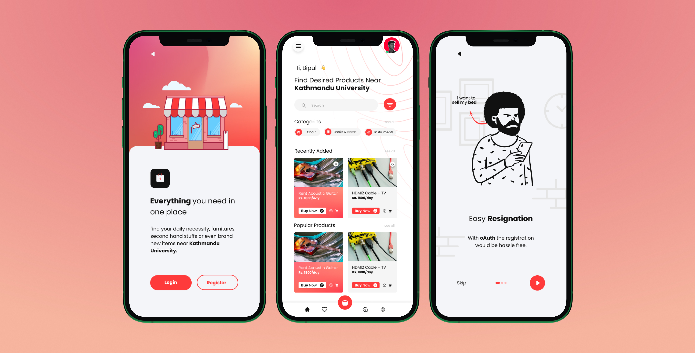
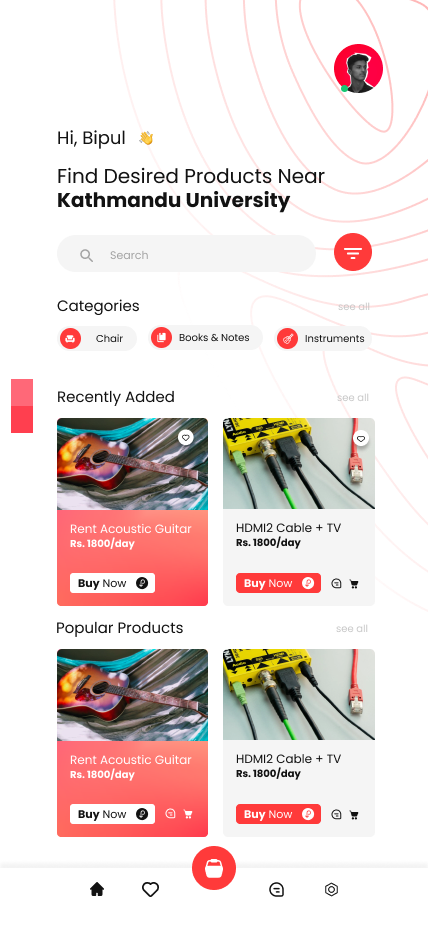
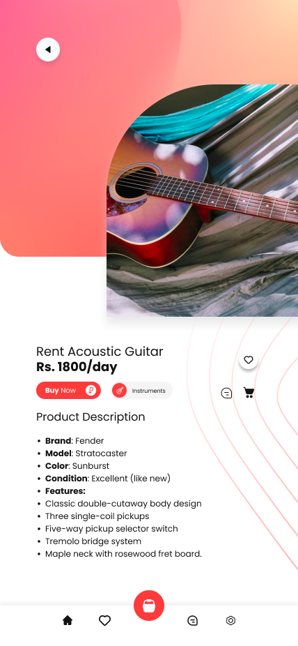
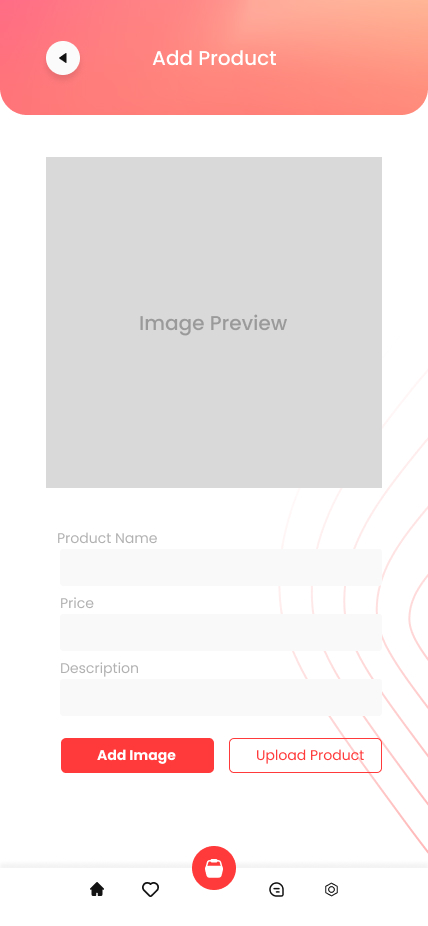

# KU Bazar

An Android marketplace for the Kathmandu University community.

KU Bazar is a place to find, buy and sell things around campus. Books you no longer need, furniture when you move out, clothes, electronics or a musical instrument someone else could use. The idea was to keep the listings and conversations with sellers in one app.

Built with **Kotlin** and **Jetpack Compose**.

[Design](https://www.figma.com/design/Bfd7JK0MBqTnhS6qUGkfwO/KU-Bazar?node-id=0-1) · [Screens](#screens) · [Run KU Bazar](#run-ku-bazar)

## Screens

The main screens take students from browsing products to reading a listing or creating one of their own.

| Home | Product details | Add a product |
| :---: | :---: | :---: |
|  |  |  |
| Browse categories and recently added products. | Check an item's photos, price and description. | Add product details, choose a category and attach photos. |

### Find something nearby

Browse categories such as books, clothes, electronics and furniture. Each listing gives buyers the main details they need when deciding whether an item is right for them. Save items as favourites to find them again later.

### List something to sell

Sellers can add a product name, choose a category, set a price, describe the item and include photos. A clear listing helps other students understand what is for sale before they contact the seller.

### Talk to the seller

KU Bazar includes conversations between buyers and sellers. They can use chat to ask questions about an item and discuss the next steps.

### A local marketplace

Campus needs change each term. A book, desk or appliance that one student has finished using may be just what another student is looking for. KU Bazar gives those everyday exchanges a place to happen within the university community.

## Android app and backend

KU Bazar has two parts: the Android app and separate backend services. The app connects to the backend for product listings, accounts, product photos and conversations.

The backend is where the app gets shared marketplace information. Using a separately deployed backend means listings and conversations are available through the app rather than being tied to one phone.

To use the whole marketplace:

1. Deploy and start the backend services.
2. Configure the Android app to connect to your deployed backend and sign-in service.
3. Build and install the app on an Android phone or emulator that can reach the backend.

For local development, run the backend and Android app together, and connect both to the same environment. The phone or emulator needs network access to the backend for products, accounts and chat to work.

The Android app is built with **Kotlin** and **Jetpack Compose**.

## Team

Built together by [Neer Aryan Bhatta](https://github.com/Neer-rn), [Bipul Lamsal](https://github.com/BipulLamsal), [Nishant](https://github.com/Nishant-cmd) and [Utkrist](https://github.com/utkrix).

